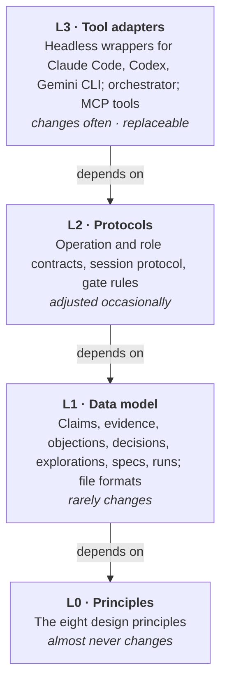
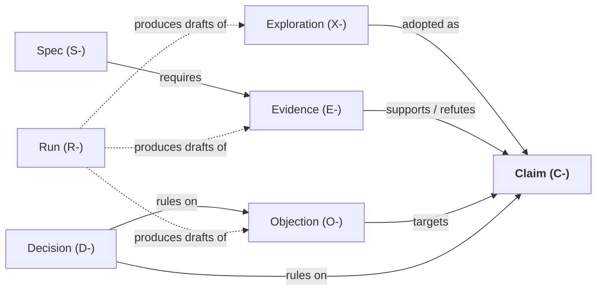
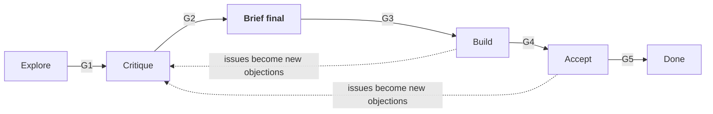

# Toulmin: Design Document (Draft)

*Status: roadmap stage 2 accepted on 2026-11-02; later stages remain draft · Last updated: 2026-11-02 · Organization: [augentic-lab](https://github.com/augentic-lab)*

*T1 revision:* The researcher authorized continuing with the proposed skeleton plan on 2026-10-31. [L1 file contracts](formats.md), [examples](format-examples.md) and [L2 protocols](protocols.md) specify the v1 format and resolve the skeleton questions below. There are no existing persisted v0 objects to migrate. L0 is unchanged; L2 now consistently separates draft output from confirmed intake.

Toulmin is a personal research workbench for systems research. It is organized around projects. Using externalized project state and fixed protocols, it lets several AI models act as reviewers, expanders, cross-validators and development leads, carrying a project from an idea to verified results. The researcher makes the final call at every gate.

The name comes from Stephen Toulmin's model of argument (claim, grounds, rebuttal), which is the shape of Toulmin's core data model: claims, the evidence behind them, and the objections against them.

---

## 1. Overview

**Goals**

- **Support thinking.** Critique and expand ideas repeatedly, and produce a research brief that has survived scrutiny.
- **Connect to engineering.** Turn a brief into development specs with acceptance criteria, then guide and verify the work of coding agents.
- **Persist across sessions.** A project can be resumed in any session, with any model, without losing progress.
- **Stay portable.** Depend on no specific tool or model.

**Primary output: the Research Brief.** One or two pages covering: the problem; why now; how big the problem is; the closest prior work; the strongest objections and the responses to them; the kill criteria; and the minimal validation experiment. The test of a good brief is whether it can be taken straight to an advisor or collaborator to decide whether to start the project. Paper notes, weekly digests and the assumption ledger are intermediate products that serve the brief.

**Users and environment.** A single researcher. Mostly CLI-based (Claude Code, Codex CLI and Gemini CLI, all used through subscriptions), with occasional use of desktop apps.

**Non-goals**

- Choosing research topics or making gate decisions on the researcher's behalf
- Writing papers automatically
- Fully autonomous "AI scientist" pipelines
- A general-purpose platform for other people

---

## 2. Design principles (L0)

These eight principles should almost never change. Every other part of the design must be consistent with them.

1. **Externalized state.** The single source of truth for a project lives in files. A session is a replaceable worker: it reads state when it starts and writes state back when it ends. Anything not written to a file did not happen.
2. **Full traceability.** Every claim, piece of evidence, objection and decision records its origin: which model, which run, which file, or the researcher.
3. **Graded evidence.** Evidence has three grades: *verified* (measured, computed by code, or checked against an API), *model-asserted*, and *intuition*. Model-asserted evidence can never support a claim on its own.
4. **Generation and evaluation are separate.** The session that proposes an idea does not evaluate it. The session that implements code does not accept it.
5. **The researcher owns the gates.** AI may propose anything, but changes to object status and transitions between stages require the researcher's confirmation.
6. **Failure is an asset.** Rejected ideas, accepted objections and abandoned approaches are kept in full, with their reasons, as context for future judgment.
7. **Open formats.** Plain text under git. No proprietary formats and no dependence on any particular tool.
8. **Minimal core.** The core defines only what does not change with tools. Everything else belongs to the replaceable adapter layer.

---

## 3. Layered architecture

The framework has four layers. Lower layers are more stable, and dependencies only point downward: the adapter layer depends on the file formats, and the file formats depend on no tool. L0 through L2 form the tool-independent core.



**Portability test.** If all three CLIs became unavailable tomorrow and only a text editor and a new model remained, L0 through L2 would still be fully usable. Only L3 would need to be rewritten.

---

## 4. Data model: the claim–evidence–objection network (L1)

Research thinking is modeled as a network centered on **claims**. Evidence supports or refutes claims, objections attack claims, and decisions rule on claims and objections. The brief, the development specs and acceptance are all operations on this network or views of it.

| Object | ID prefix | Meaning | Key fields | Status |
| --- | --- | --- | --- | --- |
| Claim | `C-` | A testable statement, e.g. "this bottleneck exists in real workloads", "it causes 30% of tail latency" | statement, type, importance (core / secondary), origin | proposed → challenged → supported → accepted; can become refuted at any stage |
| Evidence | `E-` | Material that supports or refutes a claim | target claim, direction (supports / refutes), kind (measurement / literature / derivation / experiment / computation), grade (verified / model-asserted / intuition), provenance | valid / invalidated |
| Objection | `O-` | An attack on a claim | target claim, content, severity (fatal / major / minor), raised by, response | open / answered / accepted (claim revised) / deferred |
| Decision | `D-` | The researcher's ruling at a gate | context, choice, rejected alternatives, rationale, related objects | active / superseded |
| Exploration | `X-` | A candidate branch not yet part of the main line | content, source lens, raised by | pending / adopted (becomes a claim) / dropped |
| Spec | `S-` | One development specification | target claim, implementation requirements, acceptance criteria (what evidence is required) | todo / in progress / awaiting acceptance / passed / failed |
| Run | `R-` | One AI run | timestamp, model, role, input files, output location, session ID | completed / failed |

**Claim status rules**

- **Challenged:** at least one open objection exists.
- **Supported:** at least one piece of verified supporting evidence, and no open fatal or major objections.
- **Accepted:** supported, and confirmed by the researcher.
- **Refuted:** the researcher rules so, based on refuting evidence or an accepted objection, and a decision is recorded.

These are conditions to report, not automatic transitions. A valid verified supporting evidence item is required for supported; invalidated evidence never counts. An open minor objection can coexist with eligibility for supported, so both facts are shown without selecting a new status. Every stored status change remains a researcher decision. Claim types are problem, magnitude, mechanism, novelty, assumption and deployability; workload/hardware distinctions use tags.



**The model unifies thinking and engineering**

- The brief is a view of the network: the core claims, the evidence behind them, and the strongest objections with their responses.
- Reviewing produces objections. Expanding produces explorations and new claims.
- A development spec states which claim needs which evidence. Development, in essence, produces evidence.
- Acceptance checks whether the new evidence actually supports its claim. Problems found during acceptance flow back as new objections.

---

## 5. Repository layout and file formats

Each research workbench is a single git repository, separate from the Toulmin software/template repository. A global layer is shared across projects, each project has its own directory, and every object in the network is a small Markdown file with a metadata header.

```
research/
├── AGENTS.md                  # global rules and protocols, shared by all three tools
├── CLAUDE.md -> AGENTS.md     # symlink
├── .gemini/settings.json      # context.fileName points to AGENTS.md
├── framework/                 # the framework itself: principles, data model, protocols, changelog
├── roles/                     # role definitions, model-independent
├── global/
│   ├── profile.md             # research interests, strengths, available resources
│   ├── papers/                # structured paper notes
│   ├── assumptions/           # assumption ledger
│   └── calibration/           # model reliability records
├── tools/                     # orchestrator and adapter scripts (L3)
└── projects/<project>/
    ├── PROJECT.md             # project charter: goal, stage, constraints, recent decisions, next step
    ├── brief.md               # the research brief
    ├── claims/                # C-001.md …
    ├── evidence/              # E-001.md …
    ├── objections/            # O-001.md …
    ├── decisions/             # D-001.md …
    ├── explorations/          # X-001.md …
    ├── specs/                 # S-001.md …
    ├── runs/                  # R-001.md metadata; raw output in timestamped subdirectories
    └── sessions/              # handoff notes
```

**Why one file per object.** Clean git diffs; parallel writes from several models never conflict; easy for both models and scripts to read and write; any single object can be referenced and loaded precisely.

**Example object file**

```markdown
---
schema_version: 1
id: O-007
target: C-002
severity: major
status: open
source: {kind: run, ref: R-001, path: projects/demo/runs/20261031T100000Z-review/output.md}
confirmed_by: {actor: "Tianchi YU", at: "2026-10-31T11:00:00Z"}
created: "2026-10-31T10:00:00Z"
---
## Content
The mechanism assumes request sizes follow a fixed distribution, but in production
the share of large requests drifts over time…

## Response

## Ruling
```

**Conventions**

- IDs increase within each project and object type, including Runs (`R-001`). Cross-project references are written as `<project>/C-002`. Drafts have Run-local labels and receive formal IDs only upon confirmed intake.
- The metadata header holds only fields that machines need to read. The body is written for people and models.
- `PROJECT.md` must fit on one screen, because every session reads it.
- Summary views (the objection list, the claim status table) are generated from object files by scripts, never maintained by hand.
- The brief is handwritten; explicit `[[object-reference]]` markers are checked for existence, without claiming semantic consistency. Global papers, assumptions and calibration remain placeholders until their later roadmap stages.

---

## 6. Operations and roles (L2)

All work reduces to five operations on the network. A role is only a carrier for operations: any model can fill any role, as long as it follows the role contract.

**The five operations**

| Operation | Purpose | Produces | Performed by |
| --- | --- | --- | --- |
| Expand | Add new claims or branches | explorations, draft claims | AI |
| Critique | Attack a claim | objections | AI |
| Verify | Produce evidence for a claim | evidence (measurements, computations, checked literature) | AI plans and executes; researcher confirms |
| Rule | Change object status, advance stages | decisions | Researcher only |
| Hand off | Persist the results of a session | handoff note, `PROJECT.md` update | AI drafts; researcher reviews |

**Role contract.** Every role definition file (`roles/*.md`) must state:

- Which operation it performs
- Inputs: which files it reads, and which it explicitly does not read
- Outputs: where they go and in what format
- Permissions: read-only, or which directories it may write
- Prohibitions, e.g. a reviewer must not edit claims; an implementer must not edit acceptance criteria
- Completion criteria: what counts as acceptable output

**Initial roles**

| Role | Operation | Main inputs | Output | Permissions |
| --- | --- | --- | --- | --- |
| Expander | Expand | claims, profile, lens prompts | drafts for `explorations/` | write `runs/` only |
| Reviewer (several personas) | Critique | the brief and claims only, not the discussion history | draft objections in `runs/` | read-only |
| "Why not just use X?" | Critique | brief, related work | draft objections | read-only |
| Novelty checker | Verify | claims, paper search tools | draft evidence; citations must be API-verified | read-only + search |
| Estimator | Verify | claims, existing measurements | executable scripts and their results | write `runs/` only |
| Synthesizer | Synthesize | outputs of several models | agreements, disagreements, intake suggestions | write `runs/` only |
| Development lead | Verify (planning) | final brief | drafts for `specs/` | write `runs/` only |
| Implementer | Verify (execution) | specs, codebase | code and tests | code repository |
| Verifier | Verify (checking) | specs, code, runtime environment | acceptance evidence | read code + run tests |
| Scribe | Hand off | the current session | draft handoff note | write `runs/` only; confirmed apply updates sessions/PROJECT |

Initial reviewer personas: a program committee member who is skeptical of the motivation, an industry engineer focused on deployability, and a theorist who presses on the essence of the problem. All AI research output goes into `runs/` first and enters the object directories only after the researcher confirms it. Read-only roles emit output for the operator to archive; read-only does not authorize the role to write archive files itself. Implementer code changes are governed by the separate code repository's authorization.

---

## 7. Project lifecycle and gates

Every project passes through six stages and five gates. Gate conditions are expressed in terms of network state, and the researcher must confirm before a project moves to the next stage.



The first three stages are thinking; Build and Accept are engineering, followed by Done. Specs are prepared after the final brief and before G3, not a separate project stage.

| Gate | Enters | Pass conditions |
| --- | --- | --- |
| G1 | Critique | Core claims are written out explicitly, covering at least: the problem exists, the problem's size, the approach works, and novelty |
| G2 | Brief final | No open fatal or major objections; every core claim has verified supporting evidence, or has a pending minimal experiment in validation_plan (not a pending Claim status); kill criteria are written down |
| G3 | Build | Every spec maps to a claim, and its acceptance criteria are executable |
| G4 | Accept | The implementer reports completion and its own tests pass |
| G5 | Done | Evidence produced by the verifier's independent run supports the corresponding claims |

**Feedback and abandonment**

- Problems found during build or acceptance are recorded as new objections or as evidence refuting a claim, and the project returns to the critique stage.
- A project may be abandoned at any gate. The reason is recorded as a decision and the project directory is kept.

---

## 8. Session protocol

One session handles one task with a clear output. It reads state in a fixed order when it starts and writes state back in a fixed format when it ends.

**Two kinds of session**

- **Interactive working session:** the researcher discusses, writes and organizes with one model over a longer period. This is the main workbench.
- **Headless task session:** started in the background by the orchestrator to perform a single role (review, cross-validation, acceptance). It reads only the files it needs and cannot see the discussion history.

**Why split sessions**

- Limited context: early information gets diluted or compressed in long conversations.
- Avoiding anchoring: over a long conversation, a model increasingly agrees with earlier conclusions.
- Independence: review and acceptance must be done by sessions that did not see the creative process.
- Focus: loading only what the task needs works better than loading everything.

**When to split**

- When a task with a clear output is complete
- When the project changes stage
- When an independent view is needed (review, cross-validation and acceptance always use a fresh headless session)
- When the conversation grows long and the model starts repeating itself, forgetting conventions or drifting

**Entry protocol**

1. Read `AGENTS.md` (loaded automatically by the tool).
2. Read the project's `PROJECT.md` and the applied handoff named by its `last_handoff` field (none for a new project).
3. State the task for this session and where its output goes.
4. Read only the object files the task needs; never load the whole project.

For independent task sessions, the role contract's explicit input/exclusion list takes precedence over resident context: reviewers load the supplied brief/claims and role contract, not handoffs or discussion history. The resident entry sequence above applies to interactive work and recovery.

**Exit protocol**

1. Write this session's output to the right place (AI output goes to `runs/` first).
2. Write a handoff note: what was done, decisions made or pending, open questions, the suggested next step, and this session's ID.
3. After researcher review, apply the handoff and update recent decisions, next step and last_handoff in `PROJECT.md`. A stage change requires a separate explicit researcher ruling; handoff never advances it automatically.
4. Commit to git, referencing the related object IDs in the commit message.

**Layered context**

| Layer | Contents | When loaded |
| --- | --- | --- |
| C0 Resident | `AGENTS.md`, `PROJECT.md`, latest handoff note | every session |
| C1 Task | the claims, objections, evidence and specs the current task involves | selected per task |
| C2 Retrieval | paper notes, assumption ledger, past runs, other projects | retrieved on demand |

The iron rule: anything not written to a file did not happen.

---

## 9. Multi-model cross-validation

Cross-validation is valuable only when it is independent: three models receive the same input, perform the same operation without seeing each other's output, and a synthesis step then surfaces the disagreements, which the researcher judges personally.

**Independence rules**

- **Same input:** every model receives exactly the same files and role definition.
- **Mutual invisibility:** no model sees another model's output while running.
- **Fresh session:** every run starts a new headless session with no discussion history.
- **Read-only:** critique and checking tasks always run with read-only permissions.
- **Structured output:** a uniform format, e.g. each objection carries its target claim, content, severity and grounds.

**Synthesis.** The synthesis step outputs three categories: *agreements* (raised independently by several models), *disagreements* (opposite conclusions or very different severity judgments) and *singletons* (raised by only one model). Disagreements are shown to the researcher first, because they usually mark real uncertainty. The synthesizer role rotates among the three models so that no single model's preferences dominate over time.

**Reliability calibration**

- The researcher rules on every intake suggestion: adopted, partly adopted or rejected.
- Rulings are recorded in `global/calibration/` together with who raised the item (model and role).
- Adoption rates per model and per operation are reviewed periodically and used to adjust role assignment and quota budgets.

**No pandering.** A review loop never terminates because "the reviewer is satisfied". It terminates when the researcher has ruled on every fatal and major objection.

---

## 10. Tool adapter layer (L3)

The adapter layer wraps the headless modes of the three CLIs behind a uniform interface. The orchestrator only schedules runs, passes in files, collects output and archives it; all research logic stays in the role definitions. This layer is expected to change often, so the commands and flags below should be checked against each tool's current documentation.

| Tool | Headless invocation | Instruction file it reads | Notes |
| --- | --- | --- | --- |
| Claude Code | `claude -p`, with JSON output and session resume | `CLAUDE.md` (symlinked to `AGENTS.md`) | `--allowedTools` restricts available tools |
| Codex CLI | `codex exec`, with JSONL event output and session resume | `AGENTS.md` (concatenated from the repo root down) | read-only by default; writes must be granted explicitly |
| Gemini CLI | `gemini -p`, with JSON output | `GEMINI.md`, or `AGENTS.md` via `context.fileName` | an approval mode must be set for automation |

**Orchestrator commands (first version)**

- `toulmin init`: create the research repository layout and the shared instruction files
- `toulmin new <type> <project>`: create an object file with the next ID and a filled-in header
- `toulmin status <project>`: show the stage, open objections, claim statuses and next step
- `toulmin handoff <project>`: archive a draft; `--apply <draft>` updates sessions and non-ruling PROJECT fields only after researcher confirmation
- `toulmin review <project>`: run three independent reviews in parallel, write them to `runs/`, then synthesize and propose objections for intake
- `toulmin expand <project>`: expand by lens and write draft explorations
- `toulmin crossval <project> <question>`: have three models answer the same question independently and report agreements and disagreements
- `toulmin verify <project> <spec>`: run acceptance independently in a fresh session

**Permissions and safety**

- Critique, checking and synthesis tasks always run read-only.
- Headless modes have no human approval step, so instruction files effectively form a trust boundary. When reading external codebases, web pages or full-text papers, use read-only permissions so that instructions embedded in them cannot be executed.
- Only the researcher may delete or overwrite object files or advance a stage.

**Quota budget.** Subscription quotas are limited. Use lighter models for expansion and first-pass screening, and the strongest models for key reviews and acceptance. Record the model and duration of every run so the budget can be tuned later.

**Desktop apps.** Since all state lives in files, a desktop app can work on the same repository, as long as it follows the same entry and exit protocols.

References: [Codex CLI cheat sheet](https://devhints.io/codex) · [Gemini CLI configuration](https://huggingface.co/Jimmi42/openCLI/blob/main/docs/cli/configuration.md) · [Claude Code headless mode](https://docs.claude.com/en/docs/claude-code/headless)

---

## 11. Evolving the framework

The framework is itself an object under continuous test: it is revised based on experience, and every revision is recorded and reversible.

- **Stage retrospectives.** At the end of each project stage, review three things: which objections actually changed direction, which steps became a burden, and what information was lost in handoffs.
- **Model calibration.** Adjust the assignment of models to roles based on the statistics in `global/calibration/`.
- **Versioning.** The principles, data model and protocols under `framework/` are kept in git. Every change states its reason; major changes bump the version number.
- **Change rules by layer.** L3 can change at any time. L2 changes need a change note. L1 changes need an impact assessment on existing project files and a migration script. L0 principles should, in principle, not change.

**Two long-term tests**

- **Portability:** with every tool and model replaced, and only a text editor and a new model left, the framework still works.
- **Traceability:** five years from now, any project can be opened and every decision is still understandable: when it was made and on what basis.

---

## 12. Build roadmap

Build the skeleton first and run it by hand on a real research project, then add automation step by step. Every stage has a checkable completion criterion. During early stages, Toulmin's own development is managed with ordinary tools (issues, a TODO list, tests), not with Toulmin itself.

1. **Finalize the design.** Review this document and resolve the open questions in section 13 that affect the skeleton.
   *Done when:* L0, L1 and L2 are agreed.
2. **Skeleton.** Repository template, `AGENTS.md`, object file formats, entry and exit protocols, `init`, `new`, `status` and `handoff`. Models are invoked by hand.
   *Done when:* a real research idea goes through "write claims → manual review → objection intake → handoff → resume the next day".
   *Accepted 2026-11-02:* the researcher accepted an agent-run, same-day trial (fresh-context reviewer and resume sessions) in place of a human next-day trial. See TODO.md T5 for what that evidence does not cover.
3. **Critique.** Reviewer roles, the `review` and `crossval` commands, the synthesizer, and the objection intake flow.
   *Done when:* one brief has gone through three rounds of multi-model review, and every objection has a complete, traceable status.
4. **Expansion and checking.** Expander, novelty checker (citations verified via API), estimator (numbers computed by code).
   *Done when:* every citation and number in a brief traces back to verified evidence.
5. **Engineering bridge.** Development lead, implementer integration, verifier, the `verify` command.
   *Done when:* one spec runs end to end from definition to independent acceptance, and the acceptance evidence is written back to its claim.
6. **Signal intake.** Paper monitoring, the assumption ledger, weekly digests.
   *Done when:* over four consecutive weekly digests, at least one candidate enters exploration.

After each stage, hold a retrospective (section 11) before deciding the scope of the next one.

---

## 13. Open questions

The first four questions affected the skeleton and were resolved for stage 2. Detailed decisions and rationale are recorded in TODO.md Q1–Q9.

- [x] Claim types: problem, magnitude, mechanism, novelty, assumption, deployability; workload and hardware are tags.
- [x] Brief: handwritten, with explicit object-reference checks; no generated prose or semantic consistency claim in the skeleton.
- [x] Evidence grades: retain the three grades; repetitions, variance and environment belong in provenance/material, not new grades.
- [x] Language/interface: Python >=3.12, Typer at L3, ruamel.yaml and pytest; plain Markdown bodies. MCP is deferred.
- [ ] How does the synthesizer role rotate during cross-validation, and in what format should the researcher's rulings be recorded so they are easy to analyze?
- [x] Global knowledge base: create profile and placeholder directories now; use in-project literature Evidence initially, defer knowledge-base features to stage 6.
- [ ] Should Toulmin integrate with existing reference managers such as Zotero, or keep paper notes entirely in the repository?
- [ ] Quota budget: which operations always use the strongest model, and which can use lighter ones?
- [ ] Should prompts from existing open-source projects (e.g. ARIS, claude-scholar) be used as starting points for role definitions?
