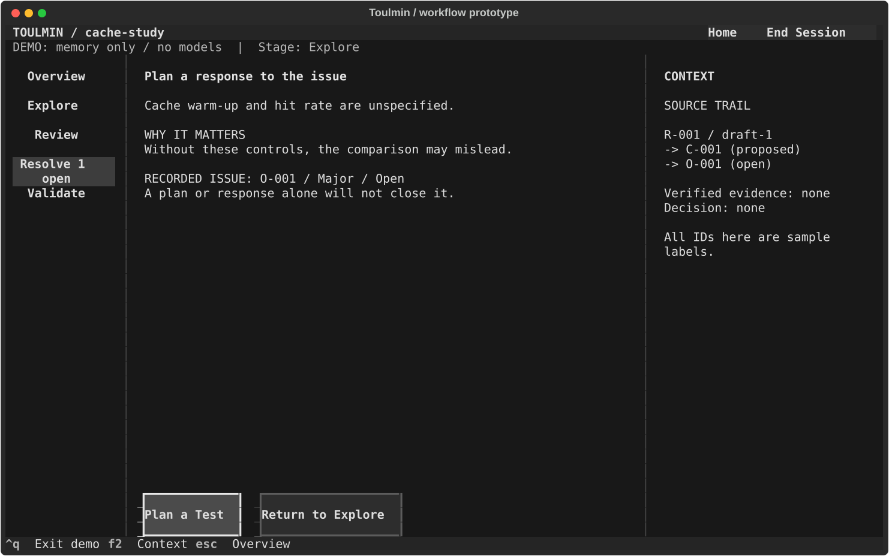

# Guided workbench wireframe (UI-R2)

This standalone terminal prototype lets you try the proposed research guidance before approving
production changes or a visual theme. It uses the existing optional Textual dependency.

From the repository root:

```sh
uv run --locked --extra tui python prototypes/guided_workbench.py
```

The fixed case asks whether caching repeated reads lowers p95 latency. All answers, object IDs,
review results and handoffs are simulated in memory. There are no model calls, research files,
network requests or real experiments. Ctrl+Q exits and discards the simulation. This is separate
from `toulmin tui`, whose current functionality is unchanged.

Try navigating before reading the route below. At each point ask:

- Can I tell what matters now and what the main button will do?
- Can I see what is saved, unconfirmed or still unresolved?
- Can I go back or stop without losing my place?

## A short route

1. New Sample Project -> Create Sample -> Resume Task.
2. Edit the brief, then Save Brief -> Save Statement. The sample statement is fixed; it is not
   extracted from your edits by a model.
3. Inspect the review inputs and exclusions, then Start Sample Review.
4. Leave the suggestion pending and resume it, or Record Issue -> Plan a Test.
5. Edit and save the plan. The issue stays open and there is still no evidence.
6. End Session -> edit the next action -> Save + Preview Reopen. Inspect Overview and Resume Task.

`Save + Preview Reopen` is an in-memory demonstration of the next-session screen, not a durable
restart test. Home -> Open Sample also revisits the current sample. Restart Sample clears it.
You can open Stage Readiness: missing magnitude/novelty keep the gate unmet, while ordinary
exploration/review remains available. Editing the saved brief after review shows stale inputs.

Tab/Shift+Tab moves focus, Enter activates a button, and Escape returns to Overview. In a text
editor Enter inserts a newline. F2 switches context at narrow widths, retaining editor content
and focus. Mouse buttons work too. At 60 columns, use the view selector instead of the rail;
scroll or Tab to reach fields below explanatory text.

## What this prototype does not test

Real conversations, asynchronous model jobs/cancellation, file persistence, evidence intake,
issue ruling and stage writes are not implemented here. Selecting personas/models, editing the
sample statement, dismissing a suggestion with reasons and real project import are also outside
this small walkthrough. The demo only records an issue or leaves it pending. Production Q30/Q31
scope and human usability acceptance remain separate decisions. Do not use this for research data.

## Actual terminal renders

These SVGs are exports from the runnable Textual prototype, not image-generated mockups.
The grayscale presentation is deliberately low fidelity; it is not the final pixel theme.
The SVG viewer may substitute a different font from your terminal.

| Moment | Render |
| --- | --- |
| Home | [120 columns](../docs/prototypes/guided-workbench/home-120.svg) |
| Orientation / next action | [120 columns](../docs/prototypes/guided-workbench/overview-120.svg) |
| Brief editing | [120 columns](../docs/prototypes/guided-workbench/explore-120.svg) |
| Review input plan | [120 columns](../docs/prototypes/guided-workbench/review-plan-120.svg) |
| Suggestion before intake | [120 columns](../docs/prototypes/guided-workbench/triage-120.svg) |
| Recorded issue / response options | [120 columns](../docs/prototypes/guided-workbench/issue-120.svg) |
| Test plan | [80 columns](../docs/prototypes/guided-workbench/validate-80.svg) / [60 columns](../docs/prototypes/guided-workbench/validate-60.svg) |
| Simulated return | [120 columns](../docs/prototypes/guided-workbench/resume-120.svg) |



Regenerate screenshots (the output directory is explicit; no research files are written):

```sh
uv run --locked --extra tui python prototypes/render_guided_workbench.py /tmp/toulmin-wireframes
```

The automated interaction tests check the path at 120x36, 80x24 and 60x20, action hit geometry,
pending/recorded distinction, unsaved edits, context focus, stale review input, early handoff,
restart and unchanged working directory. They do not prove the design is clear to a researcher.
